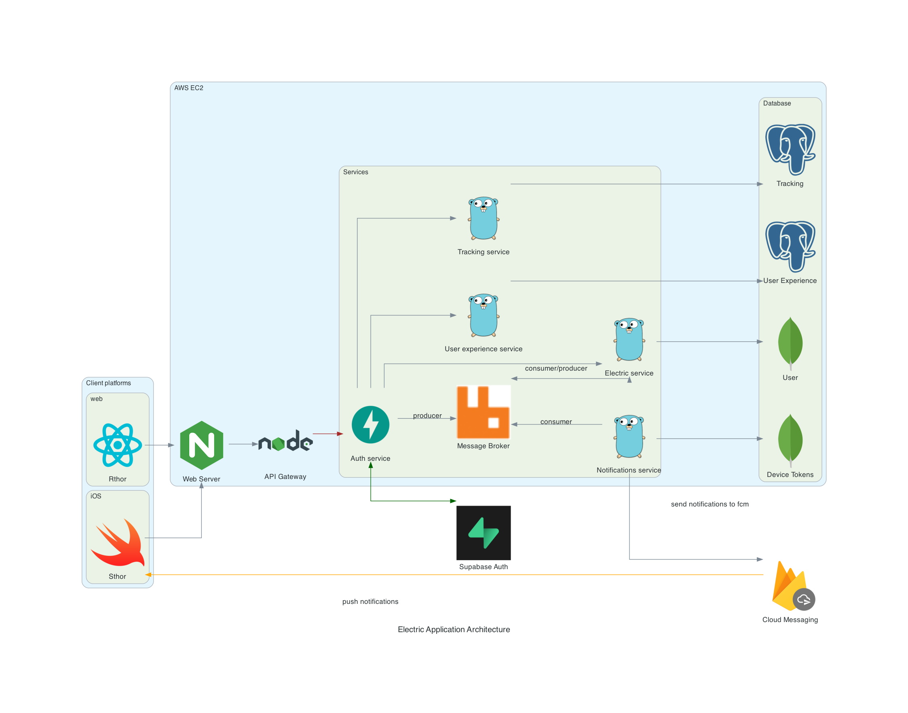

# electric-application

Electric application contains its own backend services, message broker, API gateway, frontend services. 

## Frontend services

### rthor - react thor (Private repo)

Web application to serve content built with NextJS, React

### Sthor - swift thor (Private repo)

iOS application to serve content built with Swift, SwiftUI

## Backend services

### electric-auth (Private repo)

Manages authentication & authorization for electric application written in Python, [FastApi](https://fastapi.tiangolo.com/) and [Supabase](https://supabase.com/auth)

### [electric-notifications](https://github.com/AnhCaooo/electric-push-notifications)

A service that is responsible for dealing with notifications between mobile clients and servers

### [stormbreaker](https://github.com/AnhCaooo/stormbreaker)

Fetches energy prices (electric) in real time built with Golang. Will support more types of energy such as Oil, Gas, etc

### [energy-tracking](https://github.com/AnhCaooo/energy-tracking)

A service that responsible for real time tracking, activity log to improve user experience

### [energy-user-experience](https://github.com/AnhCaooo/energy-user-experience)

A service that responsible for providing FAQs content, Search for help, sync setting across devices

## Database services

### [electric-mongo](https://github.com/AnhCaooo/electric-mongo)

### [energy-postgre](https://github.com/AnhCaooo/ernergy-postgre)

MongoDB service 

## [API gateway](https://github.com/AnhCaooo/doctor-strange) - Doctor-strange

Own custom API gateway service built with NodeJS

## electric-nginx (Private repo)
Nginx as web server and reverse proxy 

